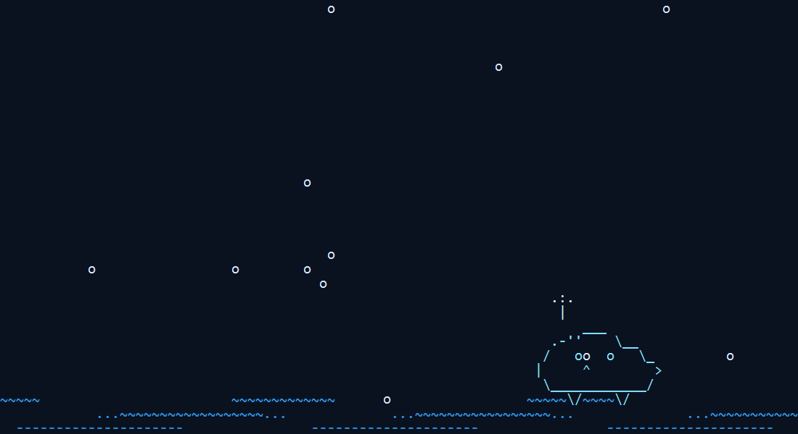

# whale_song

一只在终端里游泳的小鲸鱼。C++20 写的控制台动画：鲸鱼在水面上慢慢游动、上下起伏、头顶喷水柱，周围有气泡往上冒，底下三层水波各自摆动。



## 构建

需要 CMake 3.20+、支持 C++20 的编译器。Windows 上推荐 MSVC + Ninja：

```bat
cmake -G Ninja -S . -B build -DCMAKE_BUILD_TYPE=Release
cmake --build build
build\bin\whale_song.exe
```

## 用法

```bat
whale_song                  动画，默认 300 帧 @ 30fps
whale_song --frames 600     自定义帧数
whale_song --fps 60         自定义帧率
whale_song --once           只画一帧（静态）
whale_song --plain          不要颜色（纯 ASCII）
whale_song --ansi           即使不是终端也输出 ANSI（测试用）
whale_song --dump           导出单帧的着色分段，给外部渲染器用
whale_song --help           帮助
```

两个行为要知道：

- **重定向到文件时会自动退化成静态图**。因为 `stdout` 不是终端时，ANSI 序列只会变成一堆乱码，不如老老实实输出一帧 ASCII。
- **按 Ctrl+C 直接退出也没事**，但程序正常跑完会把光标和颜色还原。

## 它到底在画什么

画面被切成 `宽 x 高` 个格子，每格记两样东西：一个字符、一个"类别"（空 / 鲸鱼 / 波浪 / 气泡）。类别决定颜色。

每帧重新填一遍格子，然后**按行做游程编码**：同一类别连续的格子只发一次颜色转义码。不这么做的话，100x30 的画面每帧要发三千个 `\x1b[38;2;...m`，终端会当场卡住。实际一帧差不多 5 KB。

## 用了哪些 C++20 的东西

| 特性 | 用在哪 |
|---|---|
| `std::format` | 拼 ANSI 转义序列、拼 dump 输出 |
| `std::span<const char* const>` | 接命令行参数，不用自己传 `argc` |
| `std::chrono` 字面量 | `std::chrono::milliseconds(1000 / fps)` 控制帧间隔 |
| `<charconv>` 的 `std::from_chars` | 解析 `--frames` / `--fps`，比 `stoi` 稳 |
| `std::numbers` | 背后用 `std::sin` 算波浪和起伏 |
| `constexpr std::array<std::string_view, 6>` | 鲸鱼的像素画 |
| RAII（`ScreenGuard`） | 退出时还原光标和颜色，异常退出也不留烂摊子 |

## 生成 PNG

控制台里的真彩没法直接存图，所以拆成两步：

```powershell
# 1. 导出一帧的着色分段（制表符分隔）
build\bin\whale_song.exe --dump > frame.tsv

# 2. 用 GDI+ 按分段画成 PNG（字体宽度是实测的，保证不错位）
powershell -ExecutionPolicy Bypass -File tools\render-frame.ps1 -Out frame.png
```

`tools\render-frame.ps1` 里那句 `MeasureString("M", ...)` 是关键：不量一下等宽字体的实际字符宽度，100 列画到后面就歪了。

## 小坑备忘

- **中文注释的 .ps1 必须存成 UTF-8 **带 BOM**。Windows PowerShell 5.1 读无 BOM 的 UTF-8 会按 GBK 解，把注释解成乱码，接着报一堆莫名其妙的空引用。
- **执行策略默认禁止跑脚本**。要么 `-ExecutionPolicy Bypass`，要么别用脚本。
- 中文版 MSVC 的 `/showIncludes` 提示是本地化的，Ninja 认不出就会刷屏，CMakeLists 里显式设了 `CMAKE_CL_SHOWINCLUDES_PREFIX`。
